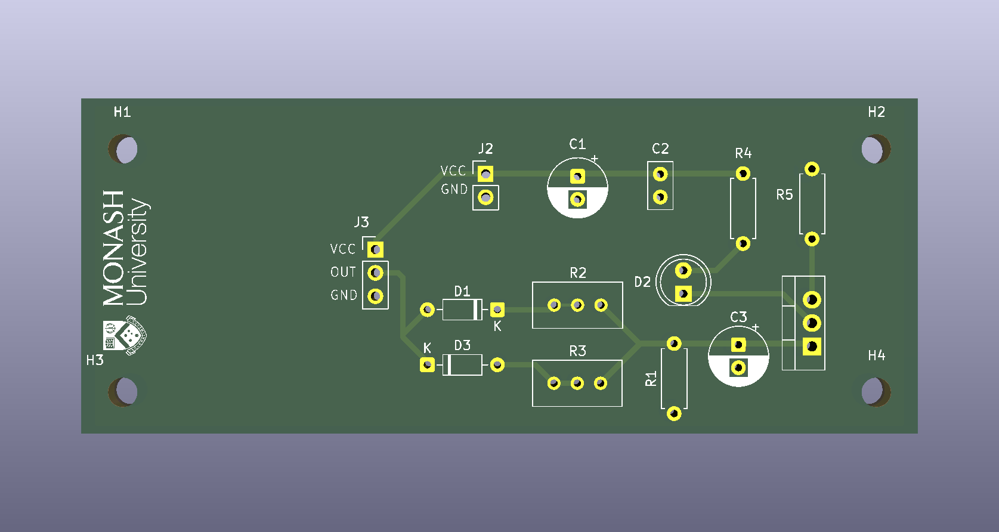

# PIR Motion-Activated LED Fader PCB

A two-layer PCB designed in KiCad 10. It turns an LED on when a PIR motion sensor detects movement, with adjustable fade-in and fade-out times.

## Circuit

| Section | Description |
|---|---|
| Power input | 5 V through J2, with 100 µF bulk and 100 nF decoupling capacitors |
| PIR interface | 3-pin headers (VCC / OUT / GND) for the PIR sensor module |
| Fade timing control | `PIR_out` charges C3 (47 µF) through D1 and potentiometer R2 (fade-in), and discharges it through D3 and potentiometer R3 (fade-out). R1 (1 MΩ) provides a bleed path |
| LED driver | The C3 voltage drives the gate of an IRFZ44N N-MOSFET, which controls the LED (R4 = 330 Ω, R5 = 220 Ω) |

Because the two 1N4148 diodes face opposite directions, charging and discharging take separate paths, so the fade-in and fade-out times can be set independently with the two potentiometers.

## Board

- Two copper layers (F.Cu / B.Cu), all through-hole components
- Four M3 mounting holes (H1–H4)

## Files

| Path | Contents |
|---|---|
| `PIR_Sensor/PIR_design_updated.kicad_pro` | KiCad project |
| `PIR_Sensor/PIR_design_updated.kicad_sch` | Schematic |
| `PIR_Sensor/PIR_design_updated.kicad_pcb` | PCB layout |
| `PIR_Sensor/Schematic.pdf` | Exported schematic |
| `PIR_Sensor/Layout.png` | 3D render of the board |

## How to open

Open `PIR_Sensor/PIR_design_updated.kicad_pro` in **KiCad 10** or later. The files use the KiCad 10 format and may not open in older versions.
